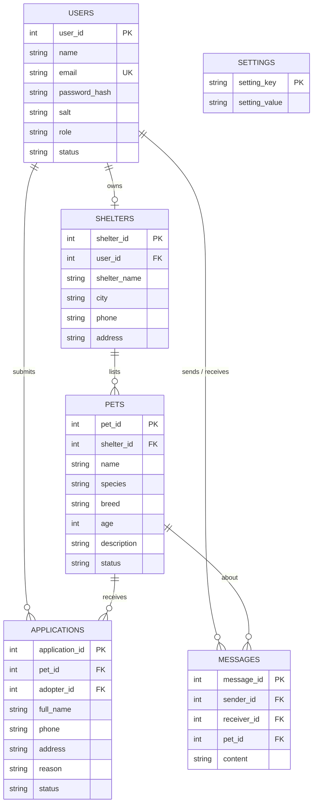

# 🐾 Online Pet Adoption Platform

A Java web application where **adopters** browse pets and apply to adopt them, **shelters** list pets and
manage applications, and an **administrator** manages users, approves listings and controls system settings.

Built with **Java 8+, Servlets, JSP/JSTL, JDBC** (H2 by default, MySQL supported) and Bootstrap 5.

---

## Features

| Role | What they can do |
|------|------------------|
| **Admin** | Create / edit / suspend / delete users and roles · approve or reject pet listings · track pending and processed applications · edit system settings (site name, adoption fee, application limit, open/closed switch) · see recent background notifications |
| **Shelter** | List pets (sent to admin for approval) · dashboard with adoption statistics · view and approve / reject applications · message applicants |
| **Adopter** | Search / filter pets · view details · submit an adoption application · track application status · message shelters |

Business rules that are enforced: only approved pets are public · one open application per adopter per pet ·
configurable limit of pending applications · approving an application marks the pet *adopted* and automatically
rejects all other pending applications for it (single JDBC transaction) · shelters can only act on their own pets ·
suspended users cannot log in · admins cannot delete or demote themselves.

## Quick start

Requirements: **JDK 8 or newer** and **Maven 3.6+**.

```bash
mvn compile exec:exec
```

Open <http://localhost:8080/>. The H2 database file is created in `./data/` and demo data is inserted on the first run.

| Role | Email | Password |
|------|-------|----------|
| Admin | admin@petadopt.com | Admin@123 |
| Shelter | shelter@petadopt.com | Shelter@123 |
| Adopter | adopter@petadopt.com | Adopter@123 |

### Alternative: deploy the WAR on Tomcat 9 (Eclipse / IntelliJ / NetBeans)

```bash
mvn clean package
```

Copy `target/pet-adoption.war` into Tomcat 9's `webapps/` folder and open `http://localhost:8080/pet-adoption/`.
(Use **Tomcat 9** – Tomcat 10+ uses the `jakarta.*` namespace and needs a code migration.)

### Using MySQL instead of H2

1. `CREATE DATABASE pet_adoption;`
2. Edit `src/main/resources/db.properties` – comment the H2 lines, uncomment the MySQL block, set your password.
3. Run again. Tables and demo data are created automatically.

## Architecture

```
Browser ──► Filter (AuthFilter: login, role, CSRF)
        ──► Servlet (controller)  ──► Service (business rules) ──► DAO (JDBC) ──► Database
        ◄── JSP + JSTL (view) ◄────────────────┘
```

```
src/main/java/com/petadoption
├── model/      User (abstract) → Admin, ShelterUser, Adopter · Pet · AdoptionApplication · Message · Shelter
│               Role, ApprovalStatus (enums) · Approvable (interface) · UserFactory
├── dao/        Dao<T,ID> (generic interface) → AbstractDao<T,ID> → UserDao, PetDao, ShelterDao,
│               ApplicationDao, MessageDao · SettingsDao · BaseDao (JDBC helpers)
├── service/    AuthService, AdoptionService, AdminService, NotificationService, RegistrationRequest
├── servlet/    BaseServlet → Login, Register, Logout, PetBrowse, Admin, Shelter, Adopter, Message
├── filter/     AuthFilter
├── listener/   AppContextListener (creates schema on start, stops threads on shutdown)
├── exception/  AppException → ValidationException, AuthenticationException, DatabaseException
└── util/       DBConnection, PasswordUtil, Validator, SchemaInitializer
src/main/webapp/WEB-INF/views   JSP pages + header/footer fragments
src/main/resources              schema.sql, db.properties
```

## Database design



## Workflow

1. Shelter registers and lists a pet → status **PENDING**
2. Admin approves → status **APPROVED** (visible to everyone)
3. Adopter searches, opens the pet and submits an application → **PENDING**
4. Shelter and adopter can exchange messages
5. Shelter approves → application **APPROVED**, pet **ADOPTED**, other applications **REJECTED** (one transaction)
6. Everyone involved gets a notification (sent by a background thread)

## Concept map (for the marking rubric)

| Rubric area | Where to look |
|-------------|---------------|
| Problem understanding & solution design | This README · 3 roles, 5 core tables + settings · layered design · workflow above |
| Core Java – inheritance & polymorphism | `User` → `Admin` / `ShelterUser` / `Adopter`, overridden `getDashboardPath()`; `UserFactory` |
| Core Java – interfaces | `Dao<T,ID>`, `Approvable` (default methods), `RowMapper` |
| Core Java – exceptions | `AppException` hierarchy, try-with-resources in all DAOs, transaction rollback |
| Core Java – collections & generics | `AbstractDao<T,ID>`, `List`, `Map`, `Deque`, `EnumMap`-style stats map, streams in servlets |
| Core Java – multithreading | `NotificationService` (thread pool + synchronized recent list) · `AdoptionService.LOCK` |
| JDBC | `DBConnection`, `BaseDao` (PreparedStatement, generated keys), `ApplicationDao.approveAndCloseOthers` (transaction), JOIN queries, schema in `schema.sql` |
| Servlets & web integration | 8 servlets with `@WebServlet`, `AuthFilter`, `AppContextListener`, sessions, forward / redirect, JSP + JSTL, flash messages |

## Security notes

Passwords are salted PBKDF2 hashes · all SQL uses `PreparedStatement` · output is escaped with `<c:out>` ·
session id is regenerated on login · every POST under `/app/*` needs a CSRF token · role checks live in a filter.

## Ideas for improvement

Pet photo upload · e-mail via JavaMail · connection pool (HikariCP) · unit tests with JUnit · pagination.

## Push to GitHub

```bash
git init
git add .
git commit -m "Online Pet Adoption Platform"
git branch -M main
git remote add origin https://github.com/<your-username>/pet-adoption-platform.git
git push -u origin main
```
